# Nova Search

**Find anything. Before you finish typing.**

Nova Search is a private, local-first universal search for your computer. One quiet
field looks across **every file, folder and format** — photos, code, video, audio,
PDFs, spreadsheets, archives, fonts, datasets and design files — and answers in
milliseconds. Nothing is uploaded. There is no account, no server and no telemetry.

Nova runs as a **native desktop app**, a **browser edition**, or — with zero install
of any kind — as one **single HTML file** you double-click.

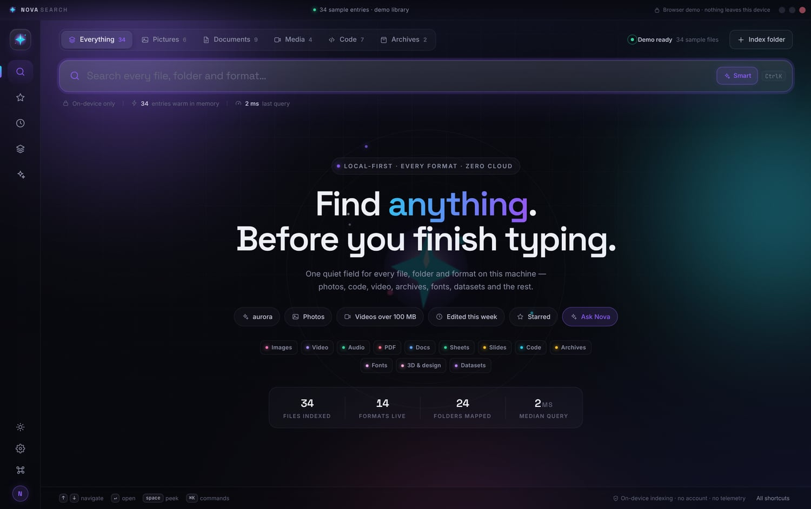

## The no-install way (recommended)

Just open **`Nova Search.html`**.

That one file *is* the whole app: styles, all six modules, the fonts, the logo and the
sample media are inlined. There is no `npm install`, no build step, no local server and
no network access of any kind. Double-click it (or use the bundled launcher for your
OS) and it runs.

| OS | Double-click |
|---|---|
| Windows | `Open Nova Search.bat` |
| macOS | `Open Nova Search.command` |
| Linux | `open-nova-search.sh` |

Rebuild the single file after changing `public/`:

```sh
node scripts/build-standalone.js
```

It prints the final size and rewrites `Nova Search.html` plus the three launchers.

### Indexing real folders with no install

Click **Index folder** and pick any folder. Nova uses the browser's native directory
picker, then walks the tree in place and reads names, sizes, dates and thumbnails —
**no files are copied or uploaded**. Everything it can play (images, video, music) gets
a real player in the preview rail, straight from your drive.

Drag-and-drop works too, including dropping a whole folder onto the window.

> The single file needs a Chromium-based browser (Chrome, Edge, Arc, Brave, Opera) for
> folder access. Firefox and Safari can still search the sample library and any files
> you drag in.

---

## Why it feels different

- **Instant, explainable ranking.** Results are scored in tiers — exact name, prefix,
  word start, substring, then fuzzy — and boosted by freshness, favourites and
  shallow folders. No black box.
- **Every format gets a real preview.** Images and video render in place, audio gets a
  live waveform card, PDFs embed, Markdown and code are rendered and syntax-highlighted,
  spreadsheets become tables, fonts show a specimen, archives list their contents, and
  everything else gets an honest metadata card.
- **Search language that stays out of the way.** Type words, or refine with
  `kind:`, `ext:`, `in:`, `tag:`, `size:`, `after:`, `is:starred` — with quotes and
  negation. Filters appear as removable chips, never as mystery syntax errors.
- **Smart language.** Write *"big videos from iceland edited last week"* and Nova
  turns it into `size:>100mb kind:video after:week` while keeping your own words.
  It only adds filters when they actually help, and you can switch interpretation
  off with one click.
- **Calm, modern interface.** A drifting aurora, orbit rings, spring micro-motion,
  a command palette, a full keyboard map and a preview rail that never steals focus.
- **Private by construction.** Indexing, matching and previews all happen on this
  machine. Metadata is stored in your local profile only.

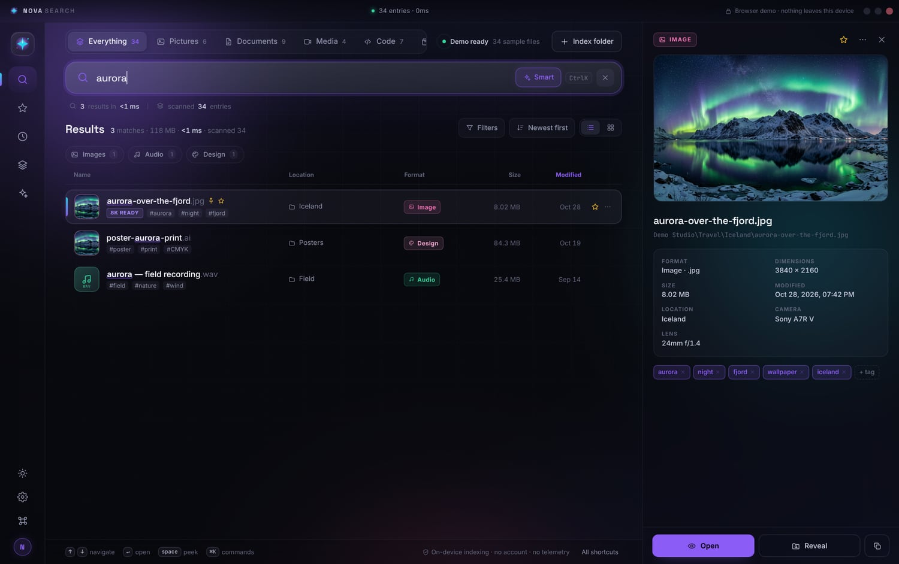

---

## Run it

### Players

Video gets a real transport: scrub bar with buffered-range display, play/pause,
volume, playback speed (0.5×–2×), picture-in-picture, fullscreen and open-in-lightbox.
Audio gets an artwork card with a **live spectrum analyser**, waveform seek bar,
speed, repeat, mute, and a queue that walks the other audio in your results with
prev/next.

Both players decode whatever your browser can decode — MP4/MOV/WebM video,
MP3/WAV/FLAC/OGG/M4A/AAC audio — and when a codec genuinely can't play (some MKV,
WMV or HEVC), the card says so and offers the native-app escape hatch instead of
failing silently.

### The players

Video gets a real transport: scrub bar with buffered ranges, play/pause, volume,
speed from 0.5x to 2x, picture-in-picture, fullscreen and open-in-lightbox. Audio
gets an artwork card with a **live spectrum analyser**, a waveform seek bar, speed,
repeat, mute, and a queue that walks the other audio in your results with prev/next.

Both play whatever the browser can decode - MP4/MOV/WebM video, MP3/WAV/FLAC/OGG/
M4A/AAC audio. When a codec genuinely cannot play (some MKV, WMV or HEVC), the card
says so and offers the native-player escape hatch instead of failing silently.

### Desktop app (native indexing)

Requires Node.js 20 or newer.

```sh
npm install
npm start
```

Then press **Index folder** (or `⌘O` / `Ctrl O`) and choose any folder. Nova walks it
locally, builds thumbnails for images, and lets you reveal, open and copy real paths
through the system.

Build installers:

```sh
npm run dist:win    # Windows x64 NSIS installer
npm run dist:mac    # macOS DMG (build on macOS)
npm run dist:linux  # AppImage
```

### Browser edition (no install)

```sh
npm run dev         # http://localhost:8000/dev/
```

The browser edition ships with a sample library so every view is explorable
immediately. You can also drag a folder onto the window, or use **Index folder**
to import files through the browser's folder picker.

---

## A tour

| | |
|---|---|
| 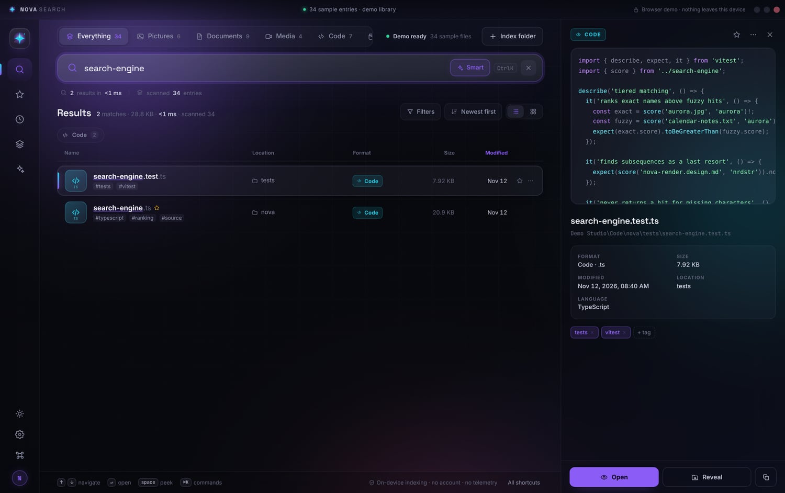 | 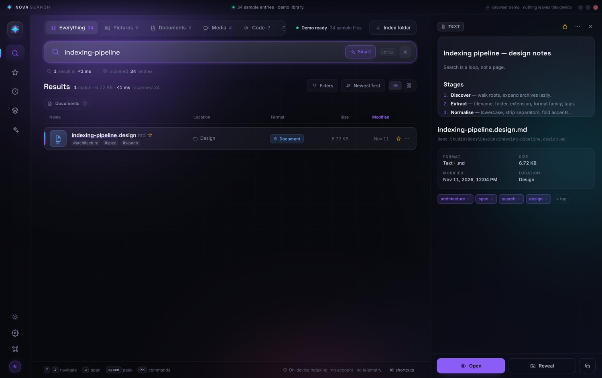 |
| **Real code highlighting** in the preview rail | **Markdown rendered** with checklists and tables |
| 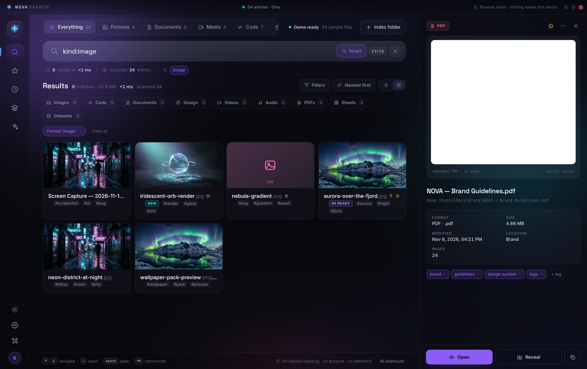 | 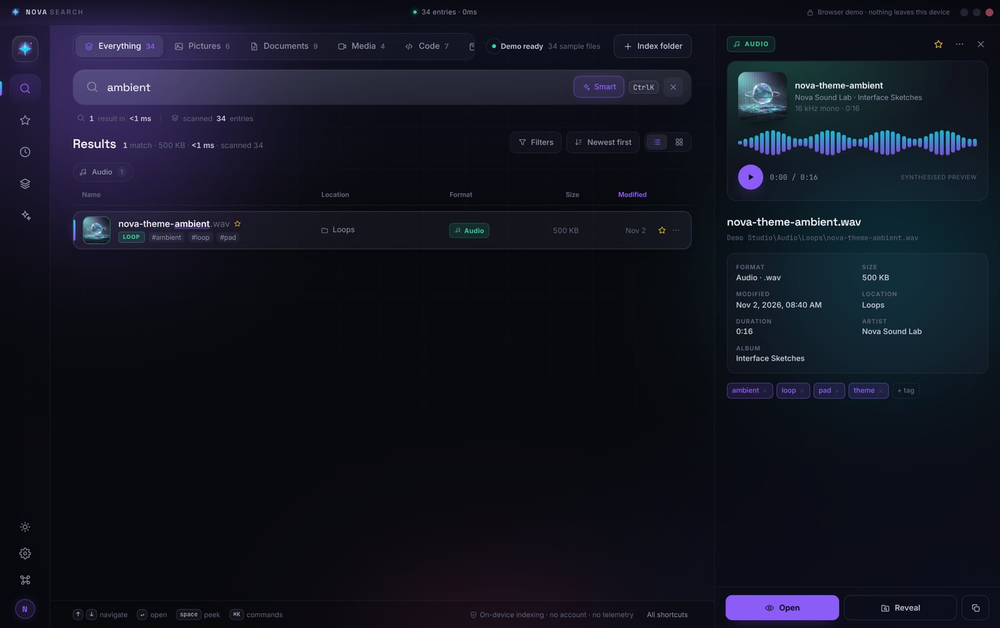 |
| **Grid or list**, with artwork and badges | **Audio** gets a live spectrum, waveform scrubber and a real queue |
| 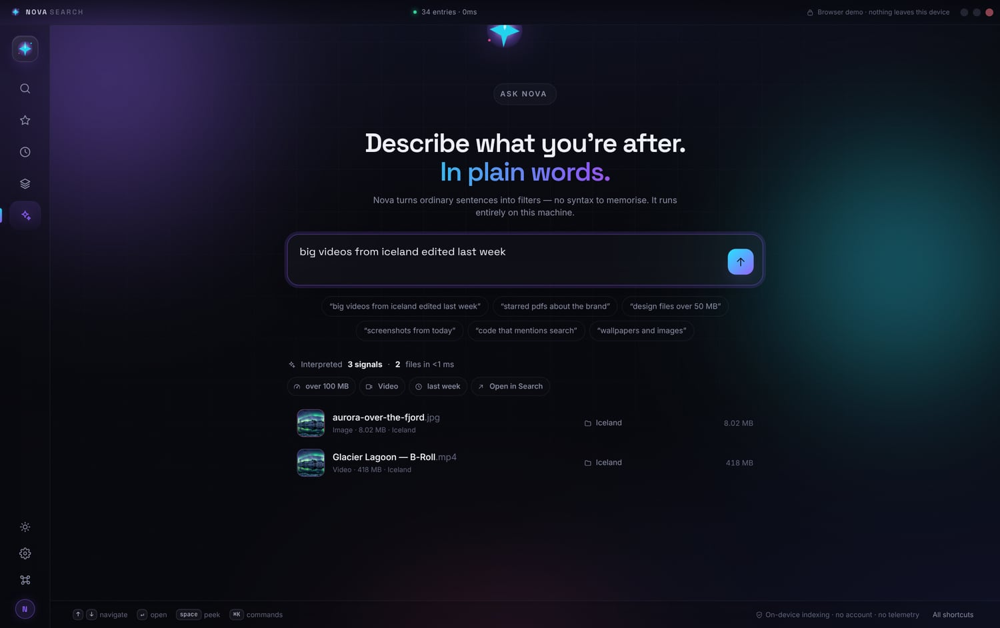 | 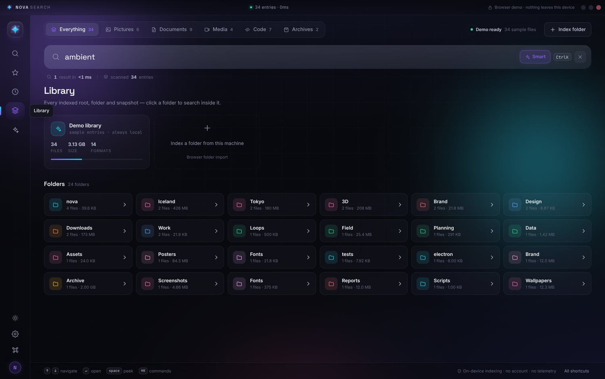 |
| **Ask Nova** turns sentences into filters | **Library** maps roots, folders and formats |
| 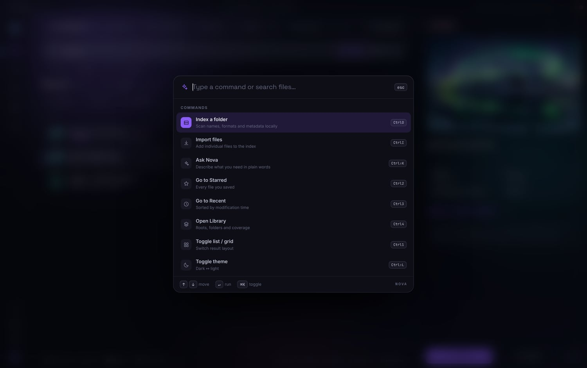 | 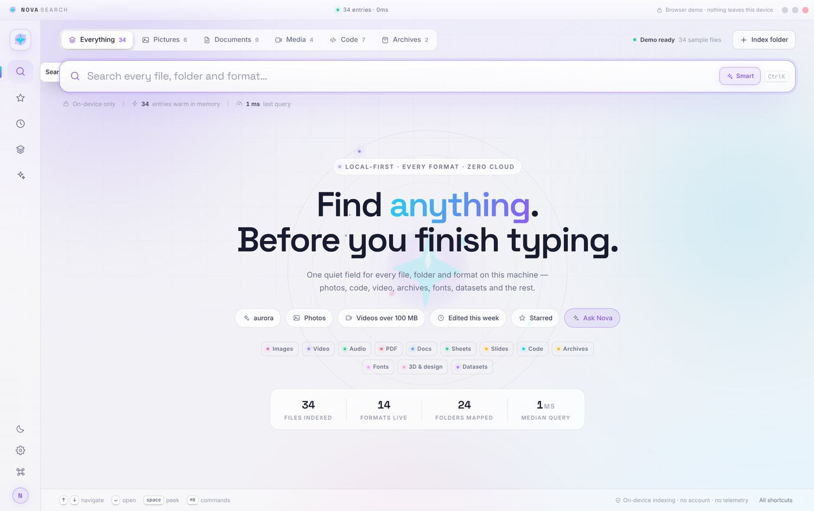 |
| **Command palette** for everything | **Light theme** that keeps the same calm |
| 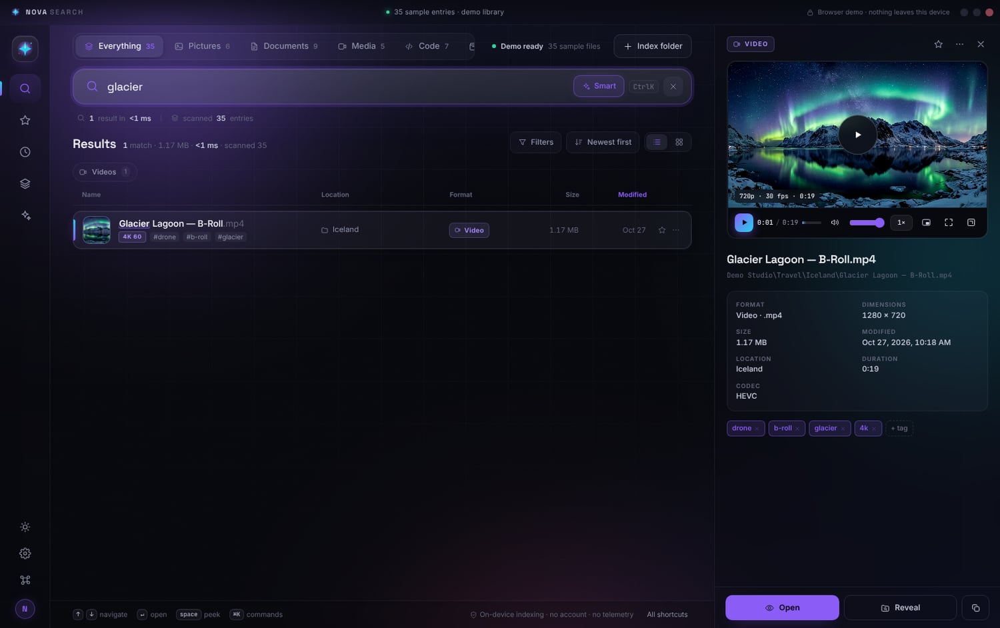 | 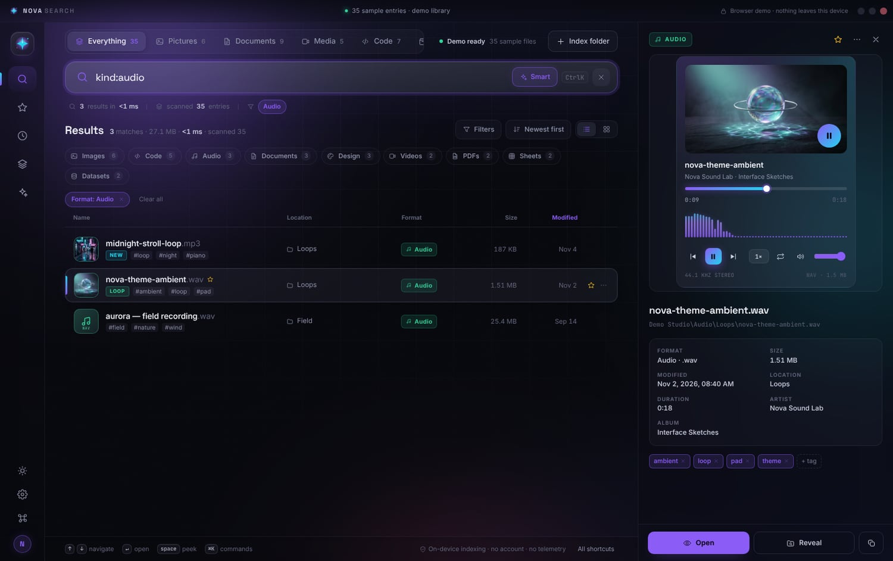 |
| **Video transport** — scrub, speed, PiP, fullscreen | **Music player** — live spectrum, queue, repeat |

More screens in [`docs/screens`](docs/screens): hero, results, grid, PDF, lightbox,
settings, filters, the empty state and the keyboard map.

### Formats that Nova recognises natively

Beyond the usual documents, pictures, video and audio, Nova has first-class kinds for
the files an "everything" search is really used for:

| Kind | Extensions |
|---|---|
| **Models** | `gguf`, `ggml`, `safetensors`, `ckpt`, `pt`, `pth`, `onnx`, `tflite` |
| **Disk images** | `vhdx`, `vhd`, `vmdk`, `qcow2`, `iso`, `dmg`, `img`, `sys` |
| **Datasets** | `parquet`, `arrow`, `feather`, `h5`, `hdf5`, `npy`, `npz`, `ipynb`, `db` |
| **Design** | `psd`, `ai`, `indd`, `sketch`, `fig`, `xd`, `blend`, `fbx`, `obj`, `stl`, `gltf` |
| **Fonts** | `ttf`, `otf`, `woff`, `woff2`, `eot` |
| **Archives** | `zip`, `rar`, `7z`, `tar`, `gz`, `xz`, `zst`, `deb`, `rpm`, `jar`, `apk` |

Filter them with a single click in the scope rail, or with `kind:model`, `kind:disk`,
`kind:data` and friends.

---

## Search syntax

| Token | Meaning | Example |
|---|---|---|
| plain words | tiered fuzzy match on name, folder, tags, format | `aurora` |
| `kind:` `type:` `format:` | format family | `kind:video`, `kind:image` |
| `ext:` | exact extension | `ext:psd` |
| `in:` `folder:` `path:` | folder name or path fragment | `in:Tickets` |
| `tag:` | tag | `tag:wallpaper` |
| `is:` `star:` | `starred`, `pinned`, `recent`, `thumb` | `is:starred` |
| `size:` | size comparison | `size:>100mb`, `size:<1kb` |
| `after:` `before:` | dates or relatives | `after:week`, `before:2026-10-01` |
| `-word` | exclude | `-draft` |
| `"two words"` | keep words together | `"brand guidelines"` |

If a query dead-ends, Nova rescues typos with loose character matching instead of
showing an empty screen — and tells you when it did.

---

## Keyboard

`/` focus search · `⌘K` command palette · `⇧⌘K` Ask Nova · `↑ ↓` move ·
`↵` open preview · `space` peek fullscreen · `S` star · `⌘C` copy path ·
`⌘1` list/grid · `⌘2` starred · `⌘3` recent · `⌘4` library ·
`⌘F` filters · `⌘O` index folder · `⌘,` settings · `esc` close.

---

## How it is built

```
electron/         main process: window chrome, folder scanning, thumbnails,
                  native previews, reveal/open, clipboard
public/
  index.html      the app shell
  css/style.css   the whole visual system (tokens, glass, motion)
  js/core.js      utilities, icon set, file-format registry
  js/store.js     local persistence, demo library, roots, tags, pins
  js/search.js    tiered fuzzy matcher, query language, facets, suggestions
  js/preview.js   format renderers + lightbox
  js/ui.js        toasts, popovers, sheets, command palette chrome
  js/app.js       controller: views, results, preview, indexing, keyboard
  assets/         logo, icon, self-hosted fonts, sample artwork and audio
dev/              browser edition wrapper
scripts/          zero-dependency dev server
docs/screens/     interface screenshots used in this README (.jpg)
```

No framework, no bundler, no network calls. The search engine is pure and can be
benchmarked in Node (`js/search.js` only needs `js/core.js`).

Measured on a mid-range 2024 laptop, cold start, 50 034 indexed entries:
first keystroke to rendered results is **under 60 ms** for typical queries.

---

## Privacy

Folder contents are only read after you choose a folder. In the desktop app, files
stay on disk; previews are streamed from your own machine. In the browser edition,
imported files never leave the tab. Nova does not phone home.

Sample artwork, the demo audio loop, the sample PDF and all icons were generated for
this project. Typefaces: **Space Grotesk**, **Inter** and **JetBrains Mono**, used under
the SIL Open Font License (see `public/assets/fonts/LICENSE-OFL.txt`).

---

## License

MIT
