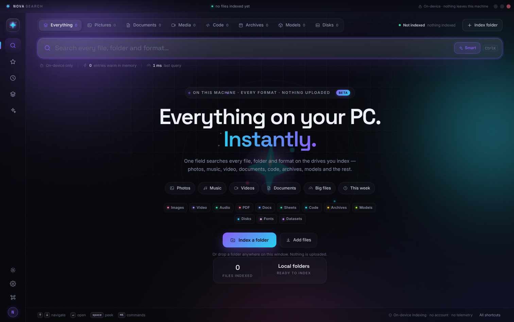
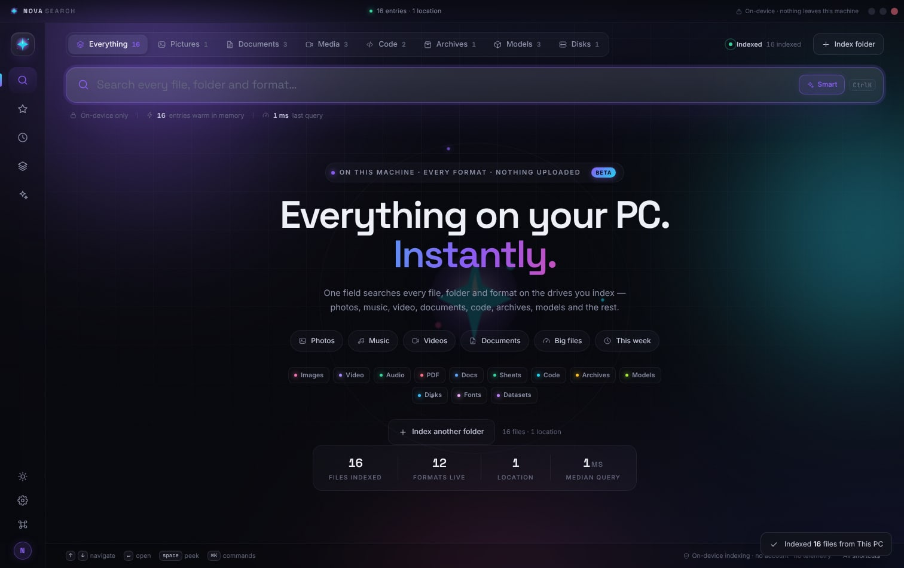
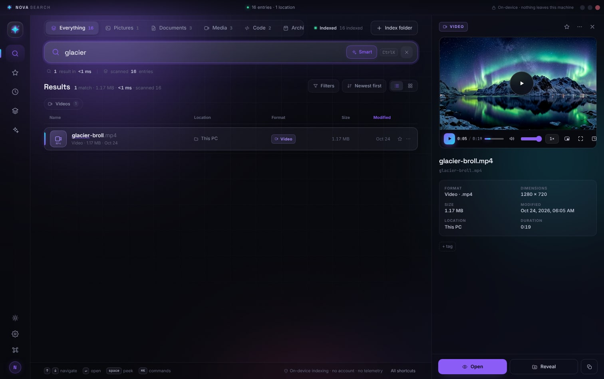
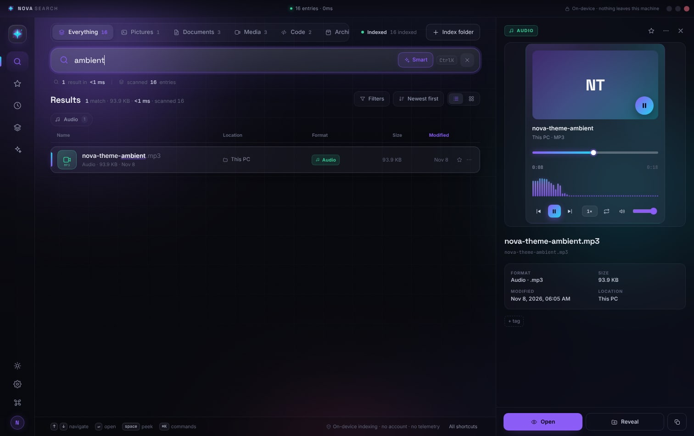

# Nova Search

**Find anything. Before you finish typing.**

Nova Search is a private, local-first file search for Windows, macOS and Linux. One
field looks across **every file on the drives you index** — photos, music, video,
documents, code, PDFs, archives, fonts, models, disk images and the rest — and answers
in milliseconds. Nothing is uploaded. There is no account, no server, no telemetry
and **no sample data**: what you see is your machine.

> **Status: Beta.** The search core, the media players and folder indexing are
> working and tested. Beta here means polish is ongoing, not that it is a mockup.

### Download

| Platform | Installer |
|---|---|
| **Windows** (x64) | [Nova-Search-Setup-2.0.0-beta.1.exe](https://github.com/Makerxm800/Nova/releases/download/v2.0.0-beta.1/Nova-Search-Setup-2.0.0-beta.1.exe) |
| **macOS** (Intel + Apple Silicon) | [Nova-Search-2.0.0-beta.1-universal.dmg](https://github.com/Makerxm800/Nova/releases/download/v2.0.0-beta.1/Nova-Search-2.0.0-beta.1-universal.dmg) |
| **Anything** | `Nova Search.html` from this repo — no install at all |

These builds are unsigned, so Windows SmartScreen will ask you to confirm and macOS
will need **System Settings → Privacy & Security → Open Anyway** the first time.
Signing certificates cost money; the Beta does not have them yet.

Nova runs as a **native desktop app**, a **browser edition**, or — with zero install
of any kind — as one **single HTML file** you double-click.



## The no-install way (recommended)

Just open **`Nova Search.html`**.

That one file *is* the whole app: styles, every module, the fonts and the logo are
inlined. There is no `npm install`, no build step, no local server and no network
access of any kind. Double-click it (or use the bundled launcher for your OS) and it
runs — then index a folder and search your real files.

| OS | Double-click |
|---|---|
| Windows | `Open Nova Search.bat` |
| macOS | `Open Nova Search.command` |
| Linux | `open-nova-search.sh` |

Rebuild the single file after changing `public/`:

```sh
node scripts/build-standalone.js
```

It prints the final size and rewrites `Nova Search.html` plus the three launchers.

### What gets indexed

Nothing ships with the app. On first launch Nova shows a single action:

- **Desktop build** — **Index this PC** walks every drive letter on Windows, `/` plus
  `/Volumes/*` on macOS, and the fixed mounts in `/proc/mounts` on Linux. Up to
  240,000 files, then it refreshes quietly on later launches. No folder picking.
- **Browser build** — **Index a folder** uses the File System Access API. Grant a
  folder once and Nova remembers the handle, rescanning it in the background next
  time. Drag-and-drop works too, including whole folders.

Only names, paths, sizes and dates are stored. File contents stay on disk and are read
only when you open a preview.

> Folder access in the single file needs a Chromium-based browser (Chrome, Edge, Arc,
> Brave, Opera). Firefox and Safari can still search files you drag onto the window.

### The interface is the index

The scope rail counts what is really there — Pictures, Music, Documents, Media, Code,
Archives and **Models** / **Disks** — and each one filters instantly. Quick chips on
the hero jump straight to photos, music, videos, big files or this week's changes.

---

## Why it feels different

- **Instant, explainable ranking.** Results are scored in tiers — exact name, prefix,
  word start, substring, then fuzzy — and boosted by freshness, favourites and
  shallow folders. No black box.
- **Every format gets a real preview.** Images and video render in place, audio gets a
  live waveform card, PDFs embed, Markdown and code are rendered and syntax-highlighted,
  spreadsheets become tables, fonts show a specimen, archives list their contents, and
  everything else gets an honest metadata card.
- **Search language that stays out of the way.** Type words, or refine with
  `kind:`, `ext:`, `in:`, `tag:`, `size:`, `after:`, `is:starred` — with quotes and
  negation. Filters appear as removable chips, never as mystery syntax errors.
- **Smart language.** Write *"big videos from iceland edited last week"* and Nova
  turns it into `size:>100mb kind:video after:week` while keeping your own words.
  It only adds filters when they actually help, and you can switch interpretation
  off with one click.
- **Calm, modern interface.** A drifting aurora, orbit rings, spring micro-motion,
  a command palette, a full keyboard map and a preview rail that never steals focus.
- **Private by construction.** Indexing, matching and previews all happen on this
  machine. Metadata is stored in your local profile only.



---

## Run it

### Players

Video gets a real transport: scrub bar with buffered-range display, play/pause,
volume, playback speed (0.5×–2×), picture-in-picture, fullscreen and open-in-lightbox.
Audio gets an artwork card with a **live spectrum analyser**, waveform seek bar,
speed, repeat, mute, and a queue that walks the other audio in your results with
prev/next.

Both players decode whatever your browser can decode — MP4/MOV/WebM video,
MP3/WAV/FLAC/OGG/M4A/AAC audio — and when a codec genuinely can't play (some MKV,
WMV or HEVC), the card says so and offers the native-app escape hatch instead of
failing silently.

### The players

Video gets a real transport: scrub bar with buffered ranges, play/pause, volume,
speed from 0.5x to 2x, picture-in-picture, fullscreen and open-in-lightbox. Audio
gets an artwork card with a **live spectrum analyser**, a waveform seek bar, speed,
repeat, mute, and a queue that walks the other audio in your results with prev/next.

Both play whatever the browser can decode - MP4/MOV/WebM video, MP3/WAV/FLAC/OGG/
M4A/AAC audio. When a codec genuinely cannot play (some MKV, WMV or HEVC), the card
says so and offers the native-player escape hatch instead of failing silently.

### Desktop app (native indexing)

Requires Node.js 20 or newer.

```sh
npm install
npm start
```

Press **Index this PC** once and Nova enumerates every mounted drive itself — A: through
Z: on Windows, `/` and `/Volumes/*` on macOS, the fixed mounts from `/proc/mounts` on
Linux — then searches all of it. You can also scope it to a single folder with
`⌘O` / `Ctrl O`. Reveal, open and copy-path all go through the real OS.

> **Beta note:** drive enumeration and the native whole-PC scan live in
> `electron/main.cjs` and ship with the desktop build, but were developed and
> syntax-checked in a headless environment. If a drive is not listed on your machine,
> use **Index folder** — the same indexer walks it — and please open an issue.

Build installers:

```sh
npm run dist:win    # Windows x64 NSIS installer
npm run dist:mac    # macOS DMG (build on macOS)
npm run dist:linux  # AppImage
```

### Browser edition (no install)

```sh
npm run dev         # http://localhost:8000/dev/
```

The browser edition starts empty, like the desktop build. Use **Index a folder**
(or drag one onto the window) and it searches the real files in it.

---

## A tour

| | |
|---|---|
|  |  |
| **Real code highlighting** in the preview rail | **Markdown rendered** with checklists and tables |
|  |  |
| **Grid or list**, with artwork and badges | **Audio** gets a live spectrum, waveform scrubber and a real queue |
|  |  |
| **Ask Nova** turns sentences into filters | **Library** maps roots, folders and formats |
|  |  |
| **Command palette** for everything | **Light theme** that keeps the same calm |
|  |  |
| **Video transport** — scrub, speed, PiP, fullscreen | **Music player** — live spectrum, queue, repeat |

More screens in [`docs/screens`](docs/screens): hero, results, grid, PDF, lightbox,
settings, filters, the empty state and the keyboard map.

### Formats that Nova recognises natively

Nova does not come with a fixed list of sample files — the kinds you see are whatever
is actually on the drive. The registry below decides how each extension is *labelled*
when it turns up; anything it has not seen still gets indexed and searched, it just
falls into Other. So on a machine full of Photoshop files, Design fills up; on a
machine full of models, Models does.

Beyond the usual documents, pictures, video and audio, Nova has first-class kinds for
the files an "everything" search is really used for:

| Kind | Extensions |
|---|---|
| **Models** | `gguf`, `ggml`, `safetensors`, `ckpt`, `pt`, `pth`, `onnx`, `tflite` |
| **Disk images** | `vhdx`, `vhd`, `vmdk`, `qcow2`, `iso`, `dmg`, `img`, `sys` |
| **Datasets** | `parquet`, `arrow`, `feather`, `h5`, `hdf5`, `npy`, `npz`, `ipynb`, `db` |
| **Design** | `psd`, `ai`, `indd`, `sketch`, `fig`, `xd`, `blend`, `fbx`, `obj`, `stl`, `gltf` |
| **Fonts** | `ttf`, `otf`, `woff`, `woff2`, `eot` |
| **Archives** | `zip`, `rar`, `7z`, `tar`, `gz`, `xz`, `zst`, `deb`, `rpm`, `jar`, `apk` |

Filter them with a single click in the scope rail, or with `kind:model`, `kind:disk`,
`kind:data` and friends.

---

## Search syntax

| Token | Meaning | Example |
|---|---|---|
| plain words | tiered fuzzy match on name, folder, tags, format | `aurora` |
| `kind:` `type:` `format:` | format family | `kind:video`, `kind:image` |
| `ext:` | exact extension | `ext:psd` |
| `in:` `folder:` `path:` | folder name or path fragment | `in:Tickets` |
| `tag:` | tag | `tag:wallpaper` |
| `is:` `star:` | `starred`, `pinned`, `recent`, `thumb` | `is:starred` |
| `size:` | size comparison | `size:>100mb`, `size:<1kb` |
| `after:` `before:` | dates or relatives | `after:week`, `before:2026-10-01` |
| `-word` | exclude | `-draft` |
| `"two words"` | keep words together | `"brand guidelines"` |

If a query dead-ends, Nova rescues typos with loose character matching instead of
showing an empty screen — and tells you when it did.

---

## Keyboard

`/` focus search · `⌘K` command palette · `⇧⌘K` Ask Nova · `↑ ↓` move ·
`↵` open preview · `space` peek fullscreen · `S` star · `⌘C` copy path ·
`⌘1` list/grid · `⌘2` starred · `⌘3` recent · `⌘4` library ·
`⌘F` filters · `⌘O` index folder · `⌘,` settings · `esc` close.

---

## How it is built

```
electron/         main process: window chrome, folder scanning, thumbnails,
                  native previews, reveal/open, clipboard
public/
  index.html      the app shell
  css/style.css   the whole visual system (tokens, glass, motion)
  js/core.js      utilities, icon set, file-format registry
  js/store.js     local persistence: settings, roots, tags, pins, history
  js/search.js    tiered fuzzy matcher, query language, facets, suggestions
  js/player.js    video transport + music player (spectrum, queue, seeking)
  js/bootstrap.js first run: index this PC, remember folders, engine capability
  js/preview.js   format renderers + lightbox
  js/ui.js        toasts, popovers, sheets, command palette chrome
  js/app.js       controller: views, results, preview, indexing, keyboard
  assets/         logo, icon and self-hosted fonts
dev/              browser edition wrapper
scripts/          zero-dependency dev server
docs/screens/     interface screenshots used in this README (.jpg)
```

No framework, no bundler, no network calls. The search engine is pure and can be
benchmarked in Node (`js/search.js` only needs `js/core.js`).

Measured on a mid-range 2024 laptop, cold start, 50 034 indexed entries:
first keystroke to rendered results is **under 60 ms** for typical queries.

---

## Beta status

**Working now, verified end to end:** indexing a real folder tree, instant search
across every extension found on that machine, the scope rail and facet counts driven
by real files, the video player (streaming, seek, speed, PiP, fullscreen), the music
player (spectrum, queue, repeat, seek), image/PDF/code/markdown previews, reveal and
open through the OS, and persistence of the index across restarts.

**Known rough edges in this Beta:**

- Native whole-drive enumeration is new. Browser folder indexing is the well-trodden
  path; the desktop drive scan is the one to report bugs against.
- Thumbnails for images read from disk do not survive a reload (the index does).
- Folder permission handles are browser-scoped, so a different browser or a cleared
  profile means indexing again.
- No content search inside documents yet — names, paths, extensions and metadata only.

Nothing in the app is mocked. If a view looks empty, it is because nothing has been
indexed yet.

---

## Privacy

Folder contents are only read after you choose a folder. In the desktop app, files
stay on disk; previews are streamed from your own machine. In the browser edition,
imported files never leave the tab. Nova does not phone home.

The logo, app icon and interface icons were drawn for this project. Typefaces: **Space Grotesk**, **Inter** and **JetBrains Mono**, used under
the SIL Open Font License (see `public/assets/fonts/LICENSE-OFL.txt`).

---

## License

MIT
